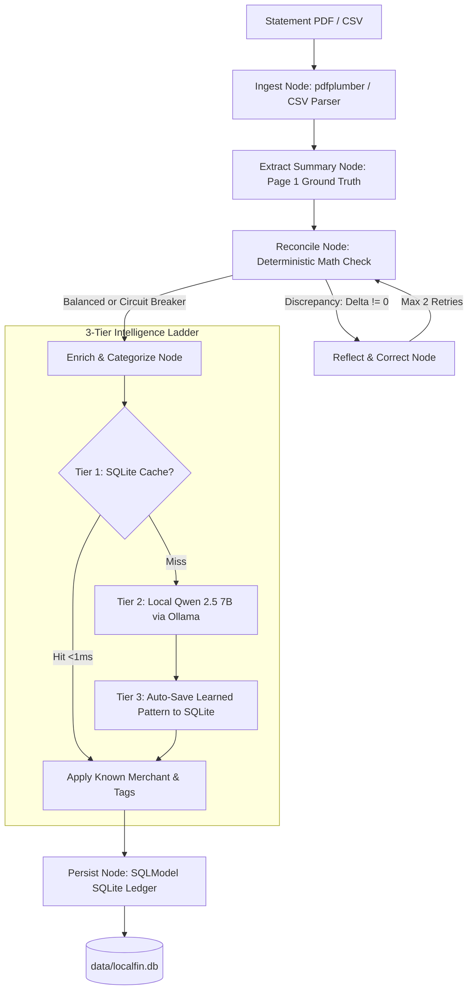

# LocalFin: Local-First Financial Statement & Transaction Intelligence Agent

[](https://www.python.org/downloads/)
[](https://fastapi.tiangolo.com/)
[](https://langchain-ai.github.io/langgraph/)
[](https://sqlmodel.tiangolo.com/)
[](https://github.com/astral-sh/ruff)
[](https://docs.pytest.org/)

**LocalFin** is a privacy-first, zero-egress financial intelligence system. It automates the extraction, schema validation, and balance reconciliation of digital bank statements (PDFs) and credit card exports (CSVs) using a deterministic **LangGraph reflection state machine**, on-device local LLMs (**Qwen 2.5 7B via Ollama**), and a unified **SQLModel relational ledger** with Model Context Protocol (**MCP**) integration.

---

## Key Architectural Highlights

* **Zero-Egress Privacy Boundary**: Financial transactions, account numbers, and personal identity data never leave your local machine. All parsing, validation, and AI enrichment execute strictly on-device.
* **Deterministic Reconciliation Invariant**: Eliminates LLM math hallucinations. Extracted line items are balanced against starting/ending statement totals ($Ending = Starting + Credits + Debits$) using strict Python floating-point math.
* **Automated Self-Healing Reflection Loop**: If a reconciliation discrepancy exists, LangGraph evaluates ambiguous line-item candidates (e.g. sign-inverted debits/credits) and heals them within a 2-retry circuit breaker.
* **3-Tier Adaptive Intelligence Engine**:
  * **Tier 1 (Memory Cache)**: Sub-millisecond (`<1ms`) regex matching against learned SQLite merchant memory.
  * **Tier 2 (Local LLM)**: Zero-egress structured entity extraction via Qwen 2.5 7B on Ollama for cache misses.
  * **Tier 3 (Autonomous Learning)**: High-confidence extractions automatically persist new merchant patterns and canonical tags to SQLite for future statements.
* **Modern SQLModel Ledger**: Replaces legacy string SQL with a unified Pydantic v2 + SQLAlchemy 2.0 ORM, featuring Many-to-Many relational tagging and atomic tag renaming.

---

## System Architecture



---

## Quick Start

### 1. Prerequisites
* **Python 3.12**
* **Ollama** running locally:
  ```bash
  ollama pull qwen2.5:7b
  ```

### 2. Local Installation
```bash
# Clone the repository
git clone https://github.com/your-username/localfin.git
cd localfin

# Create and activate environment
conda create -n localfin python=3.12 -y
conda activate localfin

# Install production and development dependencies
pip install -r requirements-dev.txt

# Install automated pre-commit hooks (Ruff + Pytest)
pre-commit install
```

### 3. Run Test Suite
```bash
pytest tests/ -v
# 23 passed in ~3.0s
```

---

## Usage

### Command Line Interface (CLI)

```bash
# 1. Ingest and reconcile a bank statement
python -m src.cli ingest path/to/chase_statement.pdf

# 2. View categorized expense breakdown
python -m src.cli summary

# 3. View spending by tag
python -m src.cli by-tag groceries

# 4. List recent transactions
python -m src.cli transactions --limit 10
```

### Running the FastAPI Server

```bash
# Start the API server
uvicorn src.api.main:app --reload --port 8000
```
Interactive OpenAPI documentation will be live at `http://localhost:8000/docs`.

#### Core Endpoints:
* `POST /api/statements/ingest`: Upload a single PDF or CSV to trigger the LangGraph reflection pipeline.
* `POST /api/statements/ingest-batch`: Asynchronously ingest multiple PDF/CSV statements. Returns HTTP `202 Accepted` with a `job_id`.
* `GET /api/jobs/{job_id}`: Poll progress (`pending`, `in_progress`, `completed`, `failed`) and view aggregated reconciliation metrics for a batch job.
* `GET /api/transactions`: Query stored transactions with date, category, and tag filters.
* `GET /api/spending/summary`: Aggregated expenses grouped by financial category.
* `GET /api/spending/by-tag`: Total spend calculation for a specific tag.
* `POST /api/tags/rename`: Atomic tag rename across all linked records.

#### Asynchronous Batch Ingestion Workflow (cURL):
```bash
# 1. Submit batch of statements (Returns HTTP 202 + job_id)
curl -X POST "http://localhost:8000/api/statements/ingest-batch" \
  -F "files=@january_statement.csv" \
  -F "files=@february_statement.pdf"

# Response:
# {"job_id":"3fa85f64-5717-4562-b3fc-2c963f66afa6","status":"pending","total_files":2,"message":"Batch ingestion job scheduled. Poll /api/jobs/{job_id} for progress."}

# 2. Poll job status until completed
curl "http://localhost:8000/api/jobs/3fa85f64-5717-4562-b3fc-2c963f66afa6"

# Response:
# {"job_id":"3fa85f64...","status":"completed","total_files":2,"processed_files":2,"result":{"total_files":2,"reconciled_files":2,"flagged_files":0,"total_transactions":58,"results":[...]}}
```

---

## Docker Deployment

Run the complete LocalFin service with persistent data storage and bridge to local Ollama:

```bash
docker compose up --build
```

---

## Project Structure

```
localfin/
├── SPEC.md                    # Formal system architecture specification
├── DECISIONS.md               # Architecture Decision Records (ADR-001 through ADR-007)
├── pyproject.toml             # Pytest & Ruff configuration
├── requirements.txt           # Minimal production dependencies
├── requirements-dev.txt       # Development & testing tooling
├── .pre-commit-config.yaml    # Automated Git hooks (Ruff, Pytest, YAML)
├── Dockerfile                 # Production Python 3.12-slim container
├── docker-compose.yml         # Container service orchestration
├── src/
│   ├── config.py              # Centralized configuration & decoupled branding
│   ├── cli.py                 # Command line runner
│   ├── api/
│   │   └── main.py            # FastAPI application & REST routes
│   ├── graph/
│   │   ├── state.py           # LangGraph AgentState TypedDicts
│   │   ├── nodes.py           # Ingestion, summary, reconcile, and persist nodes
│   │   ├── workflow.py        # StateGraph with conditional routing & circuit breaker
│   │   └── enrichment.py      # 3-Tier Adaptive Intelligence Engine
│   ├── parsers/
│   │   ├── base.py            # BaseStatementParser strategy interface
│   │   ├── csv_parser.py      # Non-destructive CSV parser with metadata preservation
│   │   └── pdf_parser.py      # Tabular & text extractor via pdfplumber
│   ├── models/
│   │   └── schemas.py         # Unified SQLModel classes & Pydantic contracts
│   └── mcp/
│       ├── db.py              # SQLModel database manager with M2M tagging
│       └── server.py          # Standalone Model Context Protocol (FastMCP) server
└── tests/
    ├── test_api.py            # FastAPI REST integration tests
    ├── test_csv_parser.py     # Ingestion & raw preservation tests
    ├── test_db.py             # Deduplication & memory cache tests
    ├── test_enrichment.py     # 3-Tier memory, Qwen Ollama, & learning loop tests
    ├── test_graph.py          # LangGraph reflection & circuit breaker tests
    ├── test_mcp_server.py     # FastMCP tool execution tests
    ├── test_schemas.py        # SHA-256 fingerprinting & contract tests
    └── test_tags.py           # Relational Many-to-Many tagging tests
```

---

## Architecture Decision Records (ADRs)

* **[ADR-001](DECISIONS.md#adr-001-zero-egress-privacy-boundary)**: Zero-Egress Privacy Boundary for Local-First Financial Processing.
* **[ADR-002](DECISIONS.md#adr-002-dual-format-ingestion-strategy)**: Dual-Format Ingestion Strategy (PDF Plumber + CSV Preservation).
* **[ADR-003](DECISIONS.md#adr-003-immutable-raw-statement-lake--re-enrichment-pipeline)**: Immutable Raw Statement Lake for Auditability and Model Upgrades.
* **[ADR-004](DECISIONS.md#adr-004-adaptive-merchant-memory--hybrid-categorization-ladder)**: Adaptive Merchant Memory & 3-Tier Categorization Ladder.
* **[ADR-005](DECISIONS.md#adr-005-sqlmodel-for-unified-pydantic--relational-persistence)**: SQLModel for Unified Pydantic Validation & Relational Persistence.
* **[ADR-006](DECISIONS.md#adr-006-internal-engine-naming-localfin-decoupled-from-product-branding)**: Internal Engine Naming (`localfin`) Decoupled from Product Branding.
* **[ADR-007](DECISIONS.md#adr-007-python-312-runtime--docker-base-image-standardization)**: Python 3.12 Runtime & Docker Base Image Standardization.

---

## License
MIT License. Created for local-first, privacy-respecting financial intelligence.
