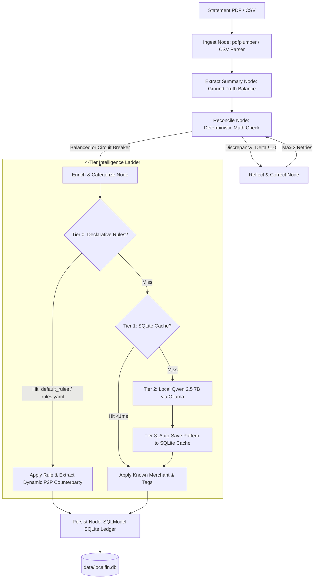

# LocalFin

**Local-first financial intelligence engine with zero cloud egress.**

LocalFin ingests bank statements (PDFs and CSVs), reconciles ledger balances using self-healing agentic reflection loops, and enriches unstructured merchant strings using a **4-tier adaptive intelligence ladder** combining declarative open rules, fast SQLite cache memory, and an on-device Qwen 2.5 7B LLM.

---

## Key Highlights

* **100% Zero-Cloud Egress**: All PDF parsing, OCR, categorization, and balance reconciliation execute strictly on your local machine. No financial transactions, balances, or credentials ever leave your device.
* **Self-Healing Agentic Reconciliation**: Built with **LangGraph**. Compares extracted transaction totals against statement summary ground truths ($Starting + Deposits - Debits = Ending$). Automatically reflects, adjusts tolerances, and retries discrepancies before persistence.
* **Accounting Sign & Date Normalization**:
  * Normalizes credit card statements to standard double-entry ledger conventions (expenses negative, debt payments positive).
  * Auto-detects institution (Chase, Discover, Citi), account type (Credit Card vs. Checking), card number masks (`****1713`), and prepends statement year to generate ISO dates (`YYYY-MM-DD`).
* **4-Tier Adaptive Intelligence Engine**:
  * **Tier 0 (Declarative Rules)**: Instant deterministic matching via open baseline rules (`src/data/default_rules.yaml`) and user overrides (`rules.yaml`). Corrects tricky vendors (e.g., Aramark corporate dining) and dynamically extracts P2P counterparty names (Zelle, Venmo).
  * **Tier 1 (Memory Cache)**: Sub-millisecond (`<1ms`) regex matching against learned SQLite merchant memory.
  * **Tier 2 (Local LLM)**: Zero-egress structured entity extraction via Qwen 2.5 7B on Ollama for cache misses.
  * **Tier 3 (Autonomous Learning)**: High-confidence extractions automatically persist new merchant patterns and canonical tags to SQLite for future statements, while barring P2P transfer strings to prevent cache poisoning.
* **Double-Count Prevention in Spending Analytics**: Inter-account credit card payoffs and transfers are categorized as `Transfer` and filtered out from spending summaries.
* **Modern SQLModel Ledger**: Replaces legacy string SQL with a unified Pydantic v2 + SQLAlchemy 2.0 ORM, featuring Many-to-Many relational tagging and atomic tag renaming.

---

## System Architecture



---

## Quick Start

### 1. Prerequisites
* **Python 3.12**
* **Ollama** running locally:
  ```bash
  ollama pull qwen2.5:7b
  ```

### 2. Local Installation
```bash
# Clone the repository
git clone https://github.com/nmhiremath/LocalFIN.git
cd LocalFIN

# Create and activate environment
conda create -n localfin python=3.12 -y
conda activate localfin

# Install production and development dependencies
pip install -r requirements-dev.txt

# Install automated pre-commit hooks (Ruff + Pytest)
pre-commit install
```

### 3. Run Test Suite
```bash
pytest tests/ -v
# 25 passed in ~2.5s
```

---

## Usage

### Command Line Interface (CLI)

```bash
# 1. Ingest and reconcile a bank statement
localfin ingest path/to/chase_statement.pdf

# 2. View categorized expense breakdown (excludes transfers)
localfin summary

# 3. View spending by tag
localfin by-tag groceries

# 4. List recent transactions
localfin transactions --limit 10
```

### Running the FastAPI Server

```bash
# Start the API server
uvicorn src.api.main:app --reload --port 8000
```
Interactive OpenAPI documentation will be live at `http://localhost:8000/docs`.

#### Core Endpoints:
* `POST /api/statements/ingest`: Upload a single PDF or CSV to trigger the LangGraph reflection pipeline.
* `POST /api/statements/ingest-batch`: Asynchronously ingest multiple PDF/CSV statements. Returns HTTP `202 Accepted` with a `job_id`.
* `GET /api/jobs/{job_id}`: Poll progress (`pending`, `in_progress`, `completed`, `failed`) and view aggregated reconciliation metrics for a batch job.
* `GET /api/transactions`: Query stored transactions with date, category, and tag filters.
* `GET /api/spending/summary`: Aggregated expenses grouped by financial category (excludes inter-account transfers).
* `GET /api/spending/by-tag`: Total spend calculation for a specific tag.
* `POST /api/tags/rename`: Atomic tag rename across all linked records.

---

## Docker Deployment

Run the complete LocalFin service with persistent data storage and bridge to local Ollama:

```bash
docker compose up --build
```

---

## Project Structure

```
LocalFIN/
├── SPEC.md                    # Formal system architecture specification
├── DECISIONS.md               # Architecture Decision Records (ADR-001 through ADR-009)
├── pyproject.toml             # Pytest & Ruff configuration
├── requirements.txt           # Minimal production dependencies
├── requirements-dev.txt       # Development & testing tooling
├── .pre-commit-config.yaml    # Automated Git hooks (Ruff, Pytest, YAML)
├── Dockerfile                 # Production Python 3.12-slim container
├── docker-compose.yml         # Container service orchestration
├── src/
│   ├── config.py              # Centralized configuration & decoupled branding
│   ├── cli.py                 # Command line runner
│   ├── api/
│   │   └── main.py            # FastAPI application & REST routes
│   ├── data/
│   │   └── default_rules.yaml # Tier 0 open fintech baseline rules
│   ├── graph/
│   │   ├── state.py           # LangGraph AgentState TypedDicts
│   │   ├── nodes.py           # Ingestion, summary, reconcile, and persist nodes
│   │   ├── workflow.py        # StateGraph with conditional routing & circuit breaker
│   │   └── enrichment.py      # 4-Tier Adaptive Intelligence Engine
│   ├── parsers/
│   │   ├── base.py            # BaseStatementParser strategy interface
│   │   ├── csv_parser.py      # Non-destructive CSV parser with sign normalization
│   │   └── pdf_parser.py      # Tabular & text extractor with ISO date & sign logic
│   ├── models/
│   │   └── schemas.py         # Unified SQLModel classes & Pydantic contracts
│   └── mcp/
│       ├── db.py              # SQLModel database manager with M2M tagging
│       └── server.py          # Standalone Model Context Protocol (FastMCP) server
└── tests/
    ├── conftest.py            # Isolated test environment fixture
    ├── test_api.py            # FastAPI REST integration tests
    ├── test_csv_parser.py     # Ingestion & raw preservation tests
    ├── test_db.py             # Deduplication & memory cache tests
    ├── test_enrichment.py     # 4-Tier memory, Qwen Ollama, & learning loop tests
    ├── test_graph.py          # LangGraph reflection & circuit breaker tests
    ├── test_mcp_server.py     # FastMCP tool execution tests
    ├── test_schemas.py        # SHA-256 fingerprinting & contract tests
    └── test_tags.py           # Relational Many-to-Many tagging tests
```

---

## Architecture Decision Records (ADRs)

* **[ADR-001](DECISIONS.md#adr-001-zero-egress-privacy-boundary)**: Zero-Egress Privacy Boundary for Local-First Financial Processing.
* **[ADR-002](DECISIONS.md#adr-002-dual-format-ingestion-strategy)**: Dual-Format Ingestion Strategy (PDF Plumber + CSV Preservation).
* **[ADR-003](DECISIONS.md#adr-003-immutable-raw-statement-lake--re-enrichment-pipeline)**: Immutable Raw Statement Lake for Auditability and Model Upgrades.
* **[ADR-004](DECISIONS.md#adr-004-adaptive-merchant-memory--hybrid-categorization-ladder)**: Adaptive Merchant Memory & Hybrid Categorization Ladder.
* **[ADR-005](DECISIONS.md#adr-005-sqlmodel-for-unified-pydantic--relational-persistence)**: SQLModel for Unified Pydantic Validation & Relational Persistence.
* **[ADR-006](DECISIONS.md#adr-006-internal-engine-naming-localfin-decoupled-from-product-branding)**: Internal Engine Naming (`localfin`) Decoupled from Product Branding.
* **[ADR-007](DECISIONS.md#adr-007-python-312-runtime--docker-base-image-standardization)**: Python 3.12 Runtime & Docker Base Image Standardization.
* **[ADR-008](DECISIONS.md#adr-008-tier-0-declarative-rules-engine--p2p-cache-poisoning-prevention)**: Tier 0 Declarative Rules Engine & P2P Cache-Poisoning Prevention.
* **[ADR-009](DECISIONS.md#adr-009-credit-card-accounting-normalization--transfer-analytics-exclusion)**: Credit Card Accounting Normalization & Transfer Analytics Exclusion.

---

## License
MIT License. Created for local-first, privacy-respecting financial intelligence.
